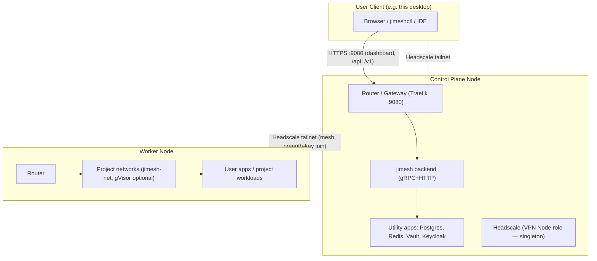

# JiMesh — Canonical Architecture & API Contract

**Status: DRAFT for operator review.** This document is the single source of truth
for what JiMesh is, what every endpoint does, and how the canvas maps onto the
domain model. It is derived from `src/backend/protos/jimesh/jimesh.proto` (the
domain spec), the store schema, and MANDATES.md. Implementation gaps are listed
explicitly at the end — nothing in here is invented.

---

## 1. What JiMesh is

JiMesh is a **self-hosted LLM proxy gateway**. Clients speak the OpenAI HTTP
protocol (`/v1/chat/completions`, `/v1/embeddings`, `/v1/models`, WebSocket
realtime). Behind the proxy, the operator models *how* requests route through
their providers on a visual canvas:

- providers contribute **API keys** (grouped per platform, pooled with cooldowns)
- providers expose **models** (catalog with prices, capabilities)
- the canvas wires **nodes** into a chain — fixed models, pools of models
  ("smart containers"), and links to other chains
- the router picks per-request using bandit statistics + quota knowledge
  (exhausted keys bench until the provider-reported reset)

One SQLite-free Go backend (CGO_ENABLED=0, PostgreSQL via pgx) serves both the
proxy and the dashboard API. Redis streams carry routing events (feedback loop)
and quota updates. The dashboard is a Next.js app.

## 2. Domain model (exactly as the proto defines it)

```
Key            one provider API key (platform, value, is_paid, model_scope,
               pool state: ok | cooldown | disabled, bandit stats)
Model          one catalog model (id, platform, prices, vision/tools, enabled)
Chain          a ROUTER. id, name, type: MAIN | FALLBACK | ESCALATION | SPECIALIZED,
               auto_skip_exhausted, bandit weights, key_selection strategy
ChainEntry     flat fallback list row of a chain (legacy/simple mode)
ChainNode      canvas node of a chain. ONE OF:
                 STATIC_MODEL     fixed model (+ optional fixed key)
                 SMART_CONTAINER  a POOL of models (members) with its own
                                  SmartRoutingConfig (weights, key selection,
                                  explore) — the router picks the best member
                                  per request
                 SUB_CHAIN_LINK   pointer to another chain (recursive routing)
ContainerMember one model inside a SMART_CONTAINER node
MeshEdge       visual edge between canvas nodes (persisted in chain metadata)
```

**Terminology contract (this was the confusion):**

| Term | Meaning | NOT |
|------|---------|-----|
| **Pool** | a SMART_CONTAINER **node inside a chain** | a chain, not a profile |
| **Chain / Router** | the whole chain = the routing unit the proxy activates | created by adding a pool |
| **Profile** | dashboard synonym for an **active chain selection** | not an entity of its own |

Creating a pool on the canvas must therefore create a **node**, never a new
chain. (This is the bug being fixed — see §6.)

## 3. Request lifecycle

```
client → POST /v1/chat/completions {model: "<chain-id>"}
  → gateway resolves the chain (explicit model param wins, else active profile)
  → if chain has NODES  → node graph routing:
        STATIC_MODEL     → that model (+key if pinned)
        SMART_CONTAINER  → bandit pick across enabled members (key scope +
                           cooldown filtering), container strategy decides
        SUB_CHAIN_LINK   → recursive Route() into the target chain
    else                → flat entries routing (bandit over entries, priority order)
  → chosen model+key → upstream call → response streamed back
  → quota pipeline: x-ratelimit headers → quota_state/observations,
    exhausted keys bench until provider reset (survives success feedback)
  → RouteEvent → Redis stream → feedback loop adjusts bandit weights
  → request summary → request_log (analytics)
  → response carries X-JiMesh-* headers (chain/platform/model/key/attempt/
    strategy/trace) + forwarded upstream x-ratelimit-*
```

Failover walks the chain order; 402 marks the key quota-exhausted (24 h bench),
429/5xx rate-limits it and the router proceeds to the next candidate.

## 4. Endpoint contract

### 4.1 Proxy (OpenAI-compatible)

| Endpoint | What it does |
|----------|--------------|
| `POST /v1/chat/completions` | routes via `model` (= chain id) or active profile; streams/fails over; sets X-JiMesh-* headers |
| `POST /v1/embeddings` | same routing for embedding models |
| `GET /v1/models` | models visible through the active chain |
| `WS /v1/realtime` | websocket pass-through with the same routing |

### 4.2 Canvas / chain graph

| Endpoint | What it does |
|----------|--------------|
| `GET /api/chains` | all chains (routers) with type + tier |
| `POST /api/chains` | create a chain (router) — id, name, type |
| `PATCH /api/chains/{id}` | rename / strategy / weights |
| `DELETE /api/chains/{id}` | delete chain (cascades entries, nodes, members, edges) |
| `POST /api/chains/active` | set the active chain (what the proxy uses) |
| `GET /api/chains/{id}/graph` | **the canvas payload: `{nodes, edges, entries}`** |
| `POST /api/chains/{id}/nodes` | add node: STATIC_MODEL, SMART_CONTAINER (pool), or SUB_CHAIN_LINK |
| `PATCH /api/chains/{id}/nodes/{nodeId}` | update node (position, enabled, smart config) |
| `DELETE /api/chains/{id}/nodes/{nodeId}` | remove node + its members |
| `POST /api/chains/{id}/nodes/{nodeId}/members` | add model to a pool node |
| `DELETE /api/chains/{id}/nodes/{nodeId}/members/{modelId}` | remove member |
| `PUT /api/chains/{id}/edges` | replace the visual edge set (drives node priority) |

Legacy aliases kept for compatibility: `GET/PUT /api/fallback*`,
`GET/POST/PATCH/DELETE /api/profiles*` (= chains). New frontend code uses the
`/api/chains/*` contract above.

### 4.3 Keys & providers

| Endpoint | What it does |
|----------|--------------|
| `GET/POST /api/keys` | list / add keys (real persistence, pool registration) |
| `PATCH/DELETE /api/keys/{id}` | toggle / edit scope / delete |
| `GET /api/keys/{id}/reveal` | decrypt value for operator copy |
| `POST /api/keys/import-preview` / `import-selected` | env/YAML/JSON bulk import with duplicate detection |
| `POST /api/keys/custom/probe` | real GET /models + real chat call against a custom base URL (honest 400/502) |
| `POST /api/keys/custom/discover-models` | real model discovery; quota headers land in the pipeline |
| `PUT/DELETE /api/platform-keys/{platform}` | platform-wide toggle (Go 1.22 mux constraint kept the path) |
| `GET /api/platform-health` + `/uptime/{platform}` | real probes, incidents, uptime windows |
| `GET /api/keys/endpoints` | per-key pool status + quota windows (from quota_state) |

### 4.4 Models

| Endpoint | What it does |
|----------|--------------|
| `GET /api/models` | catalog |
| `PATCH/DELETE /api/models/{id}` | edit / remove (id = model id; the dashboard's numeric `modelDbId` resolves to the active chain entry position) |
| `POST /api/models/discover` | pull catalogs from configured providers |

### 4.5 Analytics, quota, ops

| Endpoint | What it does |
|----------|--------------|
| `GET /api/analytics/requests` (+`/{traceId}`) | real request_log readout |
| `GET /api/fallback/rate-limit-usage` | quota windows per active-chain entry |
| `GET /api/free-tier` | free-tier rollup |
| `GET /api/health` | per-key pool status rollup |
| `GET /api/settings/*` | KV settings incl. pool presets |
| `POST /api/backups/*` | manifest-backed backup/restore (single-TX, pre-restore snapshot) |
| `GET /api/auth/status` | default-admin mode: `{needsSetup:false, authenticated:true, defaultAuth:true}` until the operator changes credentials |

## 5. Persistence rules (MANDATES)

- Startup never purges: seed defaults only create what is missing.
- Every dashboard write lands in PostgreSQL in the same request.
- Restores are single-TX with an automatic pre-restore snapshot.
- No mocks: endpoints return real data or honest empty states with a note.

## 6. Gap analysis — G1–G4 fixed, verified live

| # | Current behavior | Spec behavior | Fix | Status |
|---|------------------|---------------|-----|
| G1 | Canvas "create pool" POSTs `/api/profiles` → **creates a new chain** ("Mesh Router"), which then doesn't render as a node | create a `SMART_CONTAINER` **node** in the current chain | new node endpoints (§4.2), canvas rewired | done |
| G2 | Canvas model drop → `PUT /api/fallback` → lands as chain **entry**, invisible to node routing once nodes exist | model drop creates a `STATIC_MODEL` **node** (drop onto a pool node → member) | canvas uses node endpoints; entries stay "simple mode" | done |
| G3 | `GET /api/fallback` returns entries + edges mixed with profile concepts | `GET /api/chains/{id}/graph` returns exactly `{nodes, edges}` | new read endpoint, canvas consumes it | done |
| G4 | `auto:` prefix forced onto canvas pools → collides with builtin `auto:*` chains | pool = node id inside the chain, no synthetic chains | drop the prefix with G1 | done |
| G5 | Router node path exists and is correct (STATIC/SMART_CONTAINER/SUB_CHAIN all implemented) | — | none — keep, add tests | core verified live |

All four gaps are fixed and verified live (chain → pool node with member →
chat routes through the member; graph readback; member add/remove; node
delete). Canvas handlers now talk to /api/chains/* directly; the entries
API stays for simple-mode fallback lists only.

## 7. Deployment topology & networking

This section is the answer to the standing, repeatedly-asked question:
*"how does JiMesh actually get deployed, onto what, and how do the nodes
talk to each other?"* Node classes below are the operator's own definitions,
verbatim.

**Internal ops diagrams** (real IPs, incident timeline, sprint codenames —
deliberately gitignored, never in the public repo): `docs_dev/diagrams/`
— `architecture-overview.svg`, `deployment-pipeline.svg`, `networking.svg`,
`filesystem-volumes.svg`. Each documents its own honest gaps inline
(jimesh-router not yet deployed, only one node registered, etc.) — a
snapshot of 2026-09-16, not an evergreen promise. Ask a teammate for a
copy if you don't have `docs_dev/` locally.

**Public product diagrams** (what JiMesh does, for users/README —
no infra specifics): [`docs/diagrams/`](diagrams/).

### 7.1 The three node classes

| Class | Runs | Notes |
|-------|------|-------|
| **Control Plane** | jimesh (backend) + router + utility apps | The one place platform services (postgres/redis/vault/keycloak/backend/frontend) live. Provisioned + deployed via Ansible (`make provision-node` / `make redeploy` / `make deploy-all`). |
| **Worker Node** | router + networks + utility apps (as needed) + user apps | A node prepared via `make provision-node` (Docker + `jimesh-net` + optional gVisor) that runs project/user workloads, not JiMesh's own platform services. |
| **VPN Node** (Headscale) | Headscale (self-hosted Tailscale-compatible coordination server) | **Singleton** — exactly one Headscale deployment total, never one per Control Plane. Usually co-located on a Control Plane node (as one of its "utility apps"), but is not required to be — it can stand alone. |

### 7.2 Why not the operator's existing Tailscale

This desktop and any already-registered node may already share a
**pre-existing, real Tailscale network** the operator's company runs (used
here purely for operator/SSH/Ansible reachability). That network is
incidental infrastructure, not JiMesh's product. **JiMesh's own mesh
networking is self-hosted Headscale**, deployed by JiMesh, so a JiMesh
installation works identically regardless of what VPN (if any) the host
happens to already have. The two are unrelated and never substitute for
each other.

### 7.3 How clients join

- No OAuth/Gmail-style login against a third-party coordination service
  (that's how the real Tailscale SaaS works — explicitly not wanted here).
- Join is via **preauth key**: the operator deploys via SSH, does the
  initial login with a code from the terminal, then OAuth (against
  JiMesh's own Keycloak) — from then on the node/client is enrolled.
- A client (this desktop, a second node, an end-user machine) needs a
  small client install / `make` target to attach to the Headscale tailnet
  — tracked as an open work item (no `deploy/cp/headscale/ansible-task.yml`
  exists yet, see §7.5).

### 7.4 Topology diagram



### 7.5 Deployment mechanism & real gaps (as of 16.9.2026, verified against code)

- Provisioning/deploy is **Ansible only**, containerized (`deploy/ansible-runner/`)
  — the operator never installs Ansible locally. Targets: `config.yml`
  (tracked, names/roles/`${VAR}` refs only) + `.env` (real hosts/users,
  gitignored). `make provision-node`, `make redeploy SERVICE=<x> NODE=<y>`,
  `make deploy-all` (iterates every `role: control_plane` node over all
  platform services).
- **Real gap 1:** `config.yml` currently lists `trading` as `role: worker`.
  Per this topology it should be `role: control_plane` — not yet changed.
- **Real gap 2:** `deploy/cp/headscale/` exists but only contains an empty
  `acl/` folder — no `ansible-task.yml`/`defaults.yml`, i.e. Headscale is
  not actually deployable yet through this pipeline.
- **Real gap 3:** `deploy/docker-compose.yml` still exists (untracked) even
  though the standing directive is Ansible-only, no compose anywhere.
  Not yet removed.
- **Real gap 4:** no client-join `make` target exists yet for attaching a
  node/desktop to the Headscale tailnet once Headscale itself is deployed.

## 8. Workspace / Project / User domain model

This is the answer to the standing, repeatedly-asked question: *"what
actually is a Project, a Workspace, a Server, a User here, and how do
they relate?"* Settled with the operator 21.9.2026 after this had
drifted into two contradicting shapes in the frontend. Marked inline:
**BUILT** (real code, verified) vs **PLANNED** (agreed, not yet coded —
do not build ahead of this document without checking it's still current).

### 8.1 Definitions

- **Server** — a shared physical/virtual machine JiMesh can deploy to
  (`config.yml` node, or a registered `ssh_endpoints` entry). A server is
  NOT owned by any one Project or Workspace — many Workspaces from many
  different Projects and Users run on the same server simultaneously.
  **BUILT**: `internal/store` `control_planes` (platform's own nodes) and
  `ssh_endpoints` setting (deploy targets) both exist; neither currently
  auto-discovers what's already running on a newly-registered server
  (Backlog #092/#093, PLANNED).
- **Project** — the team-level, SHARED resource: one codebase, one
  budget, one set of chains/DB schema. What gets built. **BUILT**
  (`internal/store/store.go` `ProjectRow`).
- **Workspace** — ONE USER'S isolated, fully-duplicated working copy of
  a Project. Not a shared container: `WorkspaceRow.ProjectID` +
  `OwnerUserID` + its own container/session/git-worktree
  (`internal/store/workspaces.go`, SPRINT-37, TASK-037). **A Project's
  entire container set is duplicated per Workspace** — if "Trading Bot"
  has 6 containers, every user working on it gets their own 6, under
  their own `workspace_id`, never a container shared between two users'
  workspaces (SPRINT-37: "kein Shared-Container", literal source
  comment). This is a deliberate isolation-over-resource-cost tradeoff,
  not an oversight — revisit only with an explicit operator decision to
  share specific infra containers (e.g. one Redis per Project instead of
  per Workspace).
- **App / Container** — one deployed service inside a Workspace
  (`App.workspaceId`, one-to-many: a Workspace can and normally does have
  several). **BUILT** at the data-model level; `GET /api/deployments`
  (the route that would populate this with live data) does not exist yet
  (Backlog #128) — `WorkspaceDetailPage.tsx` shows explicitly-labeled
  demo data until that's built.
- **User** — a human (Keycloak identity) who owns zero or more Workspaces
  across one or more Projects they've been granted access to.

### 8.2 Hierarchy (the one true shape, replacing the earlier inverted version)

```
Server (shared, many Workspaces of many Projects/Users run on it)

Project (team-level, shared)
  └── Workspace (ONE per User per Project; full duplicated container set;
                  runs on exactly ONE Server, recorded as a free-text
                  label — Workspace.sshTarget — not a foreign key)
        └── App / Container (one-to-many per Workspace)
```

Server and Project are independent axes — neither is the other's parent.
A Workspace is the only entity that ties a specific Project instance to a
specific Server. **This means a single Project's workspaces can be spread
across several different Servers** (different users' workspaces for the
same project don't have to share a server) — expected, not a bug.

### 8.3 User provisioning (PLANNED, not yet built)

- Every User gets a per-user filesystem prefix on the server(s) they
  work on: `home/<user>/projects/<project>/...` by default, operator-
  configurable.
- Creating a new User is a two-step flow: (1) create the identity, (2)
  the admin picks which existing Projects this User gets access to —
  JiMesh then auto-provisions one Workspace per selected Project for
  that User (the "duplicate the whole container set" step from §8.1).
- **Shared Workspace** (distinct from a per-user Workspace): a group-
  level space multiple Users on the same Project can access together —
  configured once, at server-provisioning time, when the operator is
  asked "where does the shared workspace for this server/project live?"
  Not the default; a User can also have purely personal Workspaces with
  no Project at all (freeform — the operator's own example: "just for
  fun, put a game in there as an app").

### 8.3b Visibility / RBAC and the Project Detail page (PLANNED, 21.9.2026 — workspace_kind + provision lifecycle BUILT 28.9.2026, SPRINT-139)

- **BUILT (SPRINT-139, feat-workspace-lifecycle):** the two §8.3 workspace
  constructs are explicit DB state now — `workspaces.workspace_kind`
  (`user` = owner set, the "my project workspace" | `shared` = owner NULL,
  the "company workspace"; derived from the owner, never contradicting
  it), and the lifecycle is the deliberate chain `created →
  provisioning → provisioned → deployed → running` (+ `failed`):
  POST /api/workspaces creates ONLY the row, POST
  /api/workspaces/{id}/provision is the separate provisioning step (the
  §8 "auto-provisions one Workspace per selected Project" onboarding
  route fires that same flow), and every surface renders the chain
  (lib/workspace-status.ts). The Project-Detail-Visibility RBAC items
  below remain PLANNED.

- **Project Detail page must show Secrets + Apps as real components**,
  not separate disconnected pages — clicking a Project should surface
  its secrets and its apps inline, not require navigating away.
- **Visibility scoping**: a normal User sees only (a) Projects they
  personally have a Workspace on, and (b) the **Company Project** — a
  distinguished, always-visible Project every User sees by default (the
  default shared context, separate from `platform-internal`, which stays
  operator-only infrastructure). Only an **admin** sees every Project.
- **User-owned "scratch" section**: each User gets their own area where
  they can add ad-hoc things while developing (the operator's own
  example: a game, just for personal use) — this is the "purely
  personal Workspace, no Project" case from §8.3, given its own visible
  section rather than being buried.
- **Workspace expansion inside a Project**: expanding a Project shows
  its Workspaces, always including two default, everyone-sees-these
  entries: **"my project workspace"** (the current User's own) and
  **"company workspace"** (the shared one, §8.3's Shared Workspace).
  Other Users' individual workspaces are additional, expandable entries
  beyond those two defaults — visible per the RBAC rule above (a normal
  User does not see other Users' private workspaces on non-Company
  Projects; an admin sees all of them).

### 8.3c Secrets-Konsolidierung (PLANNED, 21.9.2026, Operator-Präzisierung)

Backlog #099 "4→1" heißt NICHT vier Tabellen technisch zusammenlegen —
es heißt: **nur Vault als Backend**, aber mit getrennten PFADEN/
Namespaces statt getrennten Speicher-Mechanismen:

- `internal/*` — Plattform-eigene Secrets (JiMesh selbst, operator-only)
- `llm/*` — LLM-Provider-Keys (die bestehende Proxy-Key-Pool-Funktion)
- `project/<projectId>/*` — geteilte Project-Secrets (für jeden Workspace-
  Inhaber mit Zugriff auf dieses Project sichtbar)
- `project/<projectId>/user/<userId>/*` — zusätzliche, NUR diesem User in
  diesem Project gehörende Secrets (obendrauf, nicht statt der Project-
  Secrets)

**Frontend-Konsequenz**: die Project-Komponente zeigt `project/<id>/*`.
Die Workspace-Ansicht eines Users zeigt BEIDES gestapelt: die
Project-Secrets (wenn er Zugriff hat) UND seine eigenen
`project/<id>/user/<userId>/*`-Secrets obendrauf — nicht eins statt dem
anderen.

### 8.4 Networking — identity-based routing, not ports (BUILT)

Real, already-implemented (TASK-079, Sprint 41,
`internal/store/workspace_routes.go`) — not a future plan:

> "Docker netns give every container its own port space — no host port
> is needed for parallel identical apps. The route row REPLACES port
> allocation." (source code comment, `workspace_routes.go`)

`jimesh-router` pulls a routing table from `GET /api/router/config`: one
row per Workspace, `{workspaceId, projectId, ownerSub, backendIp,
status}`. `ownerSub` is the Keycloak JWT `sub` of the Workspace's owner —
it travels WITH the route so the router (which holds no DB itself) can
verify at request time that the caller's verified JWT `sub` matches
before proxying. **This is the per-user isolation boundary** — not a
separate host OS user per JiMesh User (not needed: Docker's own network/
mount/process namespaces already isolate containers; a host-OS-user
layer would be an additional, currently unrequested, defense-in-depth
measure, not part of the current design).

### 8.5 Open, agreed-but-unbuilt work (PLANNED)

- **Project migration between servers** (e.g. a server fills up) — move
  a Project's workspaces to a different server. Real complication: after
  a partial migration, a Project's workspaces are legitimately split
  across servers (§8.2 already allows this), so migration must be
  per-workspace, not all-or-nothing.
- **Sidebar dual view** — SIDEBAR-UX-FINAL (27.9.2026, BUILT on branch
  `sidebar-ux-final`, docs_dev/SIDEBAR-UX-FINAL-CONCEPT.md): the SIDEBAR
  shows BOTH axes in PARALLEL sections instead of a dual-toggle —
  "ALL SSH TARGETS" (Server → Workspaces → Apps, default collapsed) and
  "PROJECTS" (Projects → Workspaces → Apps, default open), both always
  visible and individually collapsible (the operator confirmed the original
  two-section design: "BEIDE gleichzeitig sichtbar — nicht als
  Umschalter"). The axis a section is NOT grouped by rides along as a small
  tag on each row (the tag rule above, kept verbatim); workspace rows carry
  §8.3b display names ("my project workspace" / "company workspace" /
  real user name), never the UUID. ONE compact scope bar above the sections
  (summary + popover with both axes + chips) replaces the layout buttons +
  entity filter + level-modal cascade — one scope concept, two entrances:
  popover for multi, row click for navigation (lib/global-scope.ts
  unchanged). The dual view is still OPEN for the Project/Workspace DETAIL
  pages (three views total: Project-grouped, Server-grouped, and the
  single-entity detail view).
