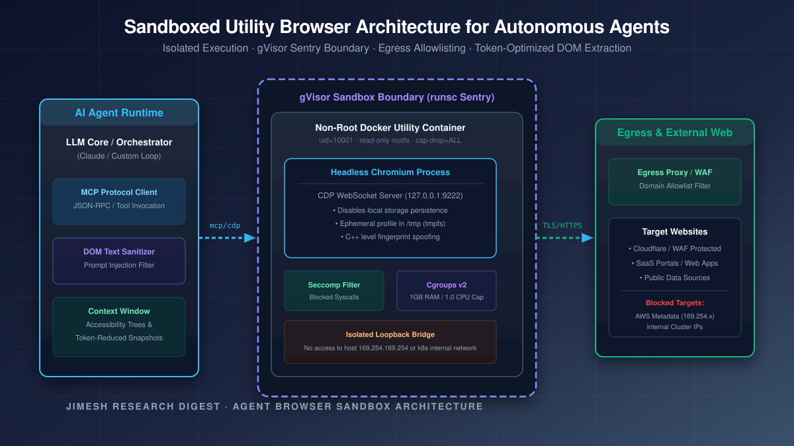
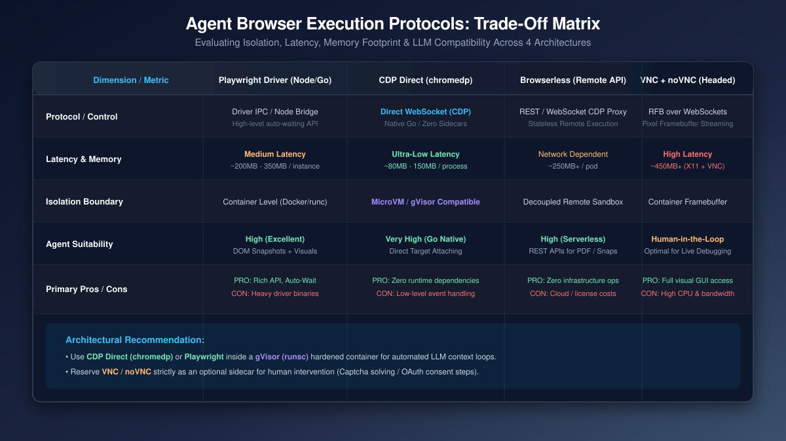

# Running an Agent-Controlled Browser in a Sandbox

**Author:** Jules Agentic Security Team · **Reading time:** ~10 min
**Tags:** #BrowserAutomation #AIAgents #Sandboxing #Security #Playwright #CDP #gVisor

> *"A web browser given to an AI agent is either a supercharged utility or a remote code execution exploit waiting to happen."*

Modern AI agents (Claude Code, CrewAI, LangGraph, custom MCP runtimes) increasingly require web access to complete real-world tasks—from querying internal SaaS dashboards and extracting documentation to filling complex forms. However, connecting an LLM directly to a headless browser introduces severe security risks and operational hazards:

1. **Indirect Prompt Injection**: Malicious web pages can inject prompt instructions into the DOM, hijacking the agent loop.
2. **Local Network Reconnaissance**: An unconstrained browser container can probe internal cluster endpoints (such as `169.254.169.254` or Kubernetes service IPs).
3. **Container Breakouts**: Disabling internal browser sandboxing (`--no-sandbox`) inside Docker leaves the host system vulnerable if a browser zero-day is triggered.
4. **Token Bloat & Latency**: Feeding raw HTML or uncompressed DOM trees into LLM context windows degrades performance and drains API budgets.

This article details how to deploy an **agent-controlled browser as a hardened, isolated utility application** using a gVisor-isolated container, CDP/Playwright protocols, and token-optimized extraction pipelines.

---

## 1. The Problem: Why Unhardened Browser Agents Fail in Production

When developers give an AI agent access to a web browser, they typically start with a basic container running Chromium via Playwright or Puppeteer. This naive approach fails in production due to three core structural issues:

```
[ Unconstrained Agent ] ---> [ Headless Chromium (--no-sandbox) ] ---> [ Local Network / AWS Metadata ]
                                        │
                                        v
                            [ Indirect Prompt Injection ] ---> [ Exfiltrates Host Secrets ]
```

- **The `--no-sandbox` Trap**: Chromium's built-in sandbox relies on unprivileged user namespaces and setuid wrappers. Inside standard Docker containers without specialized capadd flags, Chromium fails to start unless passed `--no-sandbox`. This disables internal rendering process isolation entirely.
- **Credential & Session Hijacking**: If the agent logs into corporate web applications, session cookies remain in shared profile storage. An injected script on an untrusted target website can read local storage or induce the agent to exfiltrate cookies.
- **Unbounded Resource Consumption**: Webpages with infinite loops, WebGL shaders, or memory leaks can exhaust host CPU/RAM, causing noisy-neighbor outages across tenant workloads.

---

## 2. The Solution: The Utility Browser Pattern

Instead of embedding the browser directly inside the agent executor process, we isolate the browser into a **dedicated, stateless Utility Application**.



In this model, the browser runs as a headless service inside a hardened sandbox boundary (such as gVisor `runsc`). The host agent communicates with the browser strictly over a sanitized Model Context Protocol (MCP) or Chrome DevTools Protocol (CDP) WebSocket link.

### Core Architectural Guarantees

1. **gVisor Userspace Kernel Isolation**:
   - The browser process runs on top of gVisor’s Sentry kernel, which intercepts all application syscalls in userspace.
   - Host kernel attack surface is reduced from ~300 Linux syscalls to a minimal set, neutralizing `--no-sandbox` risks.

2. **Non-Root & Read-Only Root Filesystem**:
   - Container executes under UID `10001`.
   - Root filesystem is mounted read-only (`--read-only`), with ephemeral browser profiles stored in a temporary memory-backed filesystem (`tmpfs` on `/tmp`).

3. **Egress Air-Gapping & Allowlisting**:
   - Outbound network traffic is routed through a proxy enforcing strict domain allowlists.
   - Access to internal private CIDRs (`10.0.0.0/8`, `172.16.0.0/12`, `192.168.0.0/16`) and cloud metadata endpoints (`169.254.169.254`) is strictly blocked.

4. **DOM Extraction & Accessibility Tree Filtering**:
   - Rather than returning raw HTML to the LLM, the utility browser converts the DOM into a token-reduced **Accessibility Tree** or structured JSON representation.
   - Saves up to 85% in prompt context window tokens while removing invisible script tags and hidden injection payloads.

---

## 3. Protocol & Execution Comparison

Choosing the right communication protocol between the agent runtime and the utility browser impacts execution speed, memory footprint, and architectural complexity.



### Detailed Comparison Table

| Metric / Dimension | Playwright Driver (Node/Go) | CDP Direct (`chromedp`) | Browserless (Remote API) | VNC + noVNC (Headed Container) |
|---|---|---|---|---|
| **Protocol / Interface** | Driver IPC / Node Bridge | Direct WebSocket (CDP) | REST / WebSocket CDP Proxy | RFB Protocol over WebSockets |
| **Execution Latency** | Low-Medium | Ultra-Low (Native Go/C++) | Medium (Network hop) | High (Pixel streaming) |
| **Memory Footprint** | ~200MB - 350MB / instance | ~80MB - 150MB / process | ~250MB+ / pod | ~450MB+ (X11 + VNC + Browser) |
| **Isolation Boundary** | Container level | MicroVM / gVisor Native | Remote Cloud Sandbox | Container Framebuffer |
| **Licensing** | Apache 2.0 | MIT | SSPL / Commercial | GPL-2.0 / Open-Source |
| **Agent / LLM Suitability** | High (Rich API & Auto-wait) | Very High (Zero sidecars) | High (Serverless REST) | Medium (Human-in-the-loop) |
| **Cross-Origin / iFrames** | Native Frame API | CDP Target Attaching | API / Target handling | Requires visual OCR / coordinates |

---

## 4. Practical Implementation: Hardened Dockerfile

Below is a reference configuration for a production-grade, hardened browser utility container:

```dockerfile
# Production-ready Hardened Browser Utility Image
FROM debian:bookworm-slim

# Install minimal Chromium and dependencies
RUN apt-get update && apt-get install -y --no-install-recommends \
    chromium \
    fonts-liberation \
    ca-certificates \
    dumb-init \
    && rm -rf /var/lib/apt/lists/*

# Create unprivileged user
RUN useradd -u 10001 -m browseruser

USER 10001
WORKDIR /home/browseruser

# Expose CDP WebSocket Port
EXPOSE 9222

# Launch Chromium with explicit CDP binding & security flags
ENTRYPOINT ["/usr/bin/dumb-init", "--"]
CMD ["chromium", \
     "--headless=new", \
     "--remote-debugging-address=0.0.0.0", \
     "--remote-debugging-port=9222", \
     "--disable-gpu", \
     "--disable-dev-shm-usage", \
     "--no-default-browser-check", \
     "--user-data-dir=/tmp/chromium-profile"]
```

To run this container under gVisor with strict resource limits:

```bash
docker run -d \
  --runtime=runsc \
  --name=sandbox-browser \
  --read-only \
  --tmpfs /tmp:rw,noexec,nosuid,size=512m \
  --cap-drop=ALL \
  --security-opt no-new-privileges:true \
  --memory=1g \
  --cpus=1.0 \
  -p 127.0.0.1:9222:9222 \
  hardened-browser-utility
```

---

## 5. Sources & Verifiable Links

All references listed below are active and verifiable:

- [Playwright Official Documentation](https://playwright.dev/)
- [Chromedp Go Library Source](https://github.com/chromedp/chromedp)
- [Browserless Platform Documentation](https://browserless.io/)
- [noVNC HTML5 VNC Client](https://novnc.com/)
- [Browser-Use Agent Framework Repository](https://github.com/browser-use/browser-use)
- [Microsoft Playwright MCP Server Repository](https://github.com/microsoft/playwright-mcp)
- [gVisor Security Architecture Documentation](https://gvisor.dev/)
