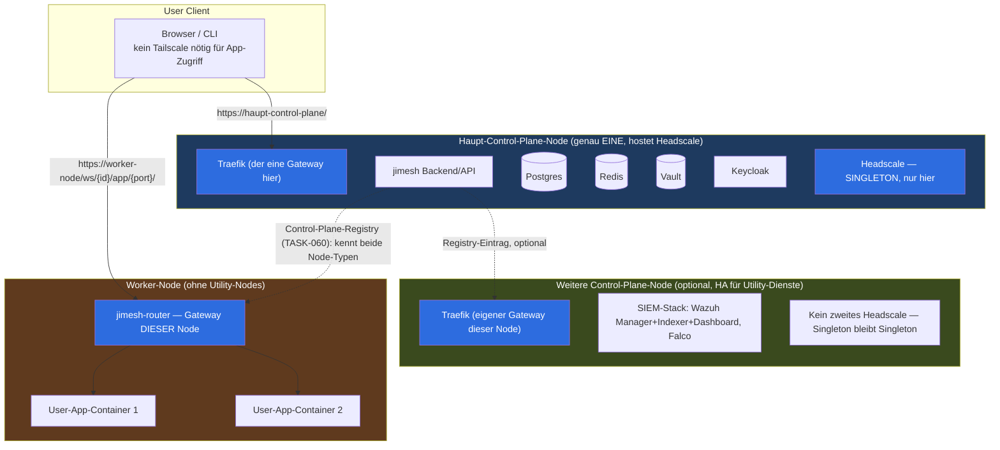
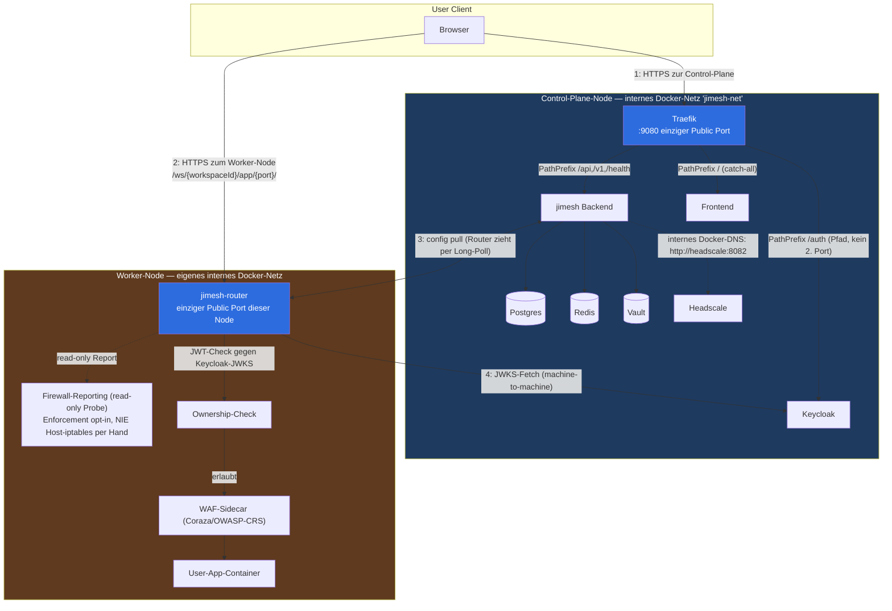

# JiMesh-Architektur — Node-Klassen & Networking-Topologie

> Stand 15.9.2026. Verbindliches Referenzdokument — ersetzt die verstreute
> Chat-Diskussion. Alle Komponenten hier sind entweder heute verifiziert real
> (Traefik, Headscale, SIEM-Stack, Control-Plane-Registry) oder als
> ausdrücklich noch offen markiert. Nichts hier wird durch manuelle
> iptables-/SSH-Config-Änderungen umgesetzt — Provisionierung läuft über
> Ansible im containerisierten Runner (`make provision-node`, siehe
> `deploy/ansible/`), Deployment über die bestehende
> Control-Plane-Registry (`/api/control-planes`).

---

## 1. Die vier Node-Klassen (allgemeines Bild)

### Die vier Klassen im Klartext

| Klasse | Zweck | Anzahl | Hat eigenen Gateway? |
|---|---|---|---|
| **Haupt-Control-Plane** | Plattform-Hirn: Backend, DB, Vault, Keycloak, **Headscale** | genau 1 | Ja (Traefik) |
| **Weitere Control-Plane** (optional) | HA/Isolation für Utility-Dienste (z.B. SIEM), NICHT für Headscale | 0..n | Ja, eigener Traefik |
| **Worker-Node** | Läuft User-Apps, kein Utility-Kram | 0..n | Ja (jimesh-router) |
| **User Client** | Browser/CLI des Operators oder Endnutzers | beliebig viele | Braucht keinen — ist der Zugreifende |

**Wichtige Regel, die heute mehrfach unklar war:** Jede Node (egal welche
Klasse) hat **genau einen** öffentlichen Eingang (Traefik oder
jimesh-router). Alles dahinter redet nur über das interne Docker-Netz
dieser einen Node. Zwei Nodes = zwei getrennte Eingänge, niemals einer für
alle.

---

## 2. Netzwerk-Topologie im Detail — ein Zugriff, Schritt für Schritt

### Was an jedem nummerierten Pfeil oben passiert

1. **User → Control-Plane:** normaler HTTPS-Request an Traefik. Traefik
   entscheidet per Pfad, wohin (`/api` → Backend, `/auth` → Keycloak,
   Rest → Frontend). Kein Tailscale-Client nötig.
2. **User → Worker-Node:** direkter HTTPS-Request an den Router dieser
   Node, URL-Form `/ws/{workspaceId}/app/{port}/...` — auch hier kein
   Tailscale-Client nötig, das ist der normale End-User-Pfad (TASK-079,
   real gebaut, siehe `cmd/jimesh-router/wsproxy.go`).
3. **Backend ↔ Router:** der Router PULLT seine Konfiguration vom Backend
   (Long-Poll gegen `/api/router/config`) — das Backend drückt nichts an
   den Worker-Node, der Worker-Node muss also nicht von der Control-Plane
   aus erreichbar sein, nur umgekehrt.
4. **Router → Keycloak:** maschinelle JWKS-Abfrage zur JWT-Prüfung — braucht
   nur eine ausgehende Verbindung vom Worker-Node zur Control-Plane, keinen
   eingehenden Port.

### Firewall — was real ist, was nicht

- **Read-only Reporting** (`jimesh-router --firewall` ohne Enforcement)
  ist Code-Realität: der Router meldet den Ist-Zustand seiner eigenen
  nftables-Regeln an die Control-Plane.
- **Enforcement** (Regeln tatsächlich durchsetzen) ist opt-in im selben
  Binary (`--firewall=true`), lief aber heute noch nie live — bewusst
  nicht mehr über Ad-hoc-Chat-Kommandos, sondern nur noch über den
  Ansible-Runner-Container oder echten Code-Pfad.
- **Was NIE passiert:** manuelle `iptables`-Kommandos auf dem Host, egal
  ob Control-Plane oder Worker-Node. Diese Regel ist nach dem heutigen
  Vorfall endgültig.

### SIEM — wo es hinpasst

Der Wazuh/Falco-Stack (`deploy/siem/`, Sprint 32, real, opt-in) beobachtet
**Worker-Node-Container** (Falco: eBPF-Tripwires speziell für
`jimesh-framework-*` Workspace-Container) und läuft selbst typischerweise
auf einer **Control-Plane-Node** (Manager+Indexer+Dashboard, aktuell
Loopback-only auf dem Haupt-Control-Plane-Host). Bei mehreren
Control-Plane-Nodes kann der SIEM-Stack auf die "weitere Control-Plane"
(Abschnitt 1) ausgelagert werden, um die Haupt-Control-Plane zu entlasten
— das ist der praktische Sinn dieser zweiten Klasse.

---

## 3. Was davon heute schon steht vs. noch offen

| Baustein | Status |
|---|---|
| Traefik auf der Haupt-Control-Plane | ✅ gebaut, live verifiziert |
| Headscale (Singleton) + Gateway-Node im Tailnet | ✅ gebaut, live verifiziert (`100.64.0.1`) |
| Control-Plane-Registry (`/api/control-planes`) | ✅ bereits vorhanden (TASK-060), ungenutzt für einen 2. echten Eintrag |
| `jimesh-router` Workspace-Proxy (TASK-079) | ✅ Code real, nie live deployed |
| Ansible-Runner + `make provision-node` | ✅ gerade gebaut, noch nicht gegen einen echten Server gelaufen (fehlende Zugangsdaten) |
| Keycloak über Traefik-Pfad `/auth` | ❌ noch nicht verdrahtet (aktuell eigener Port `127.0.0.1:8081`) |
| Zweite Control-Plane-Node (SIEM-HA) | ❌ Konzept, 0 Code |
| Firewall-Enforcement (nicht nur Reporting) | ❌ nie live getestet |
| Headscale-OIDC-Device-Flow | ❌ nicht konfiguriert |
