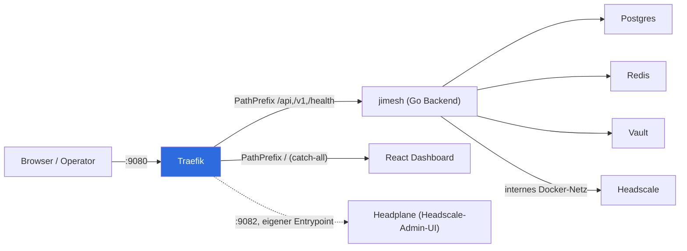
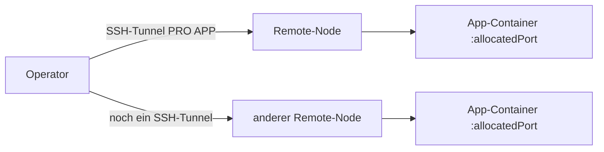
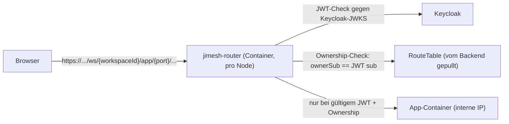
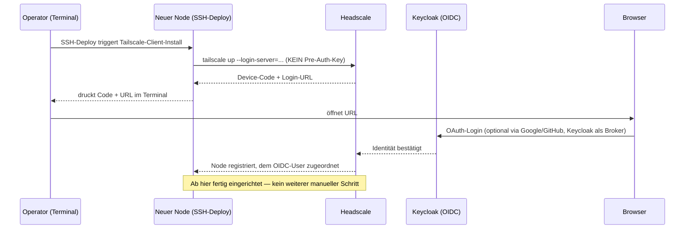
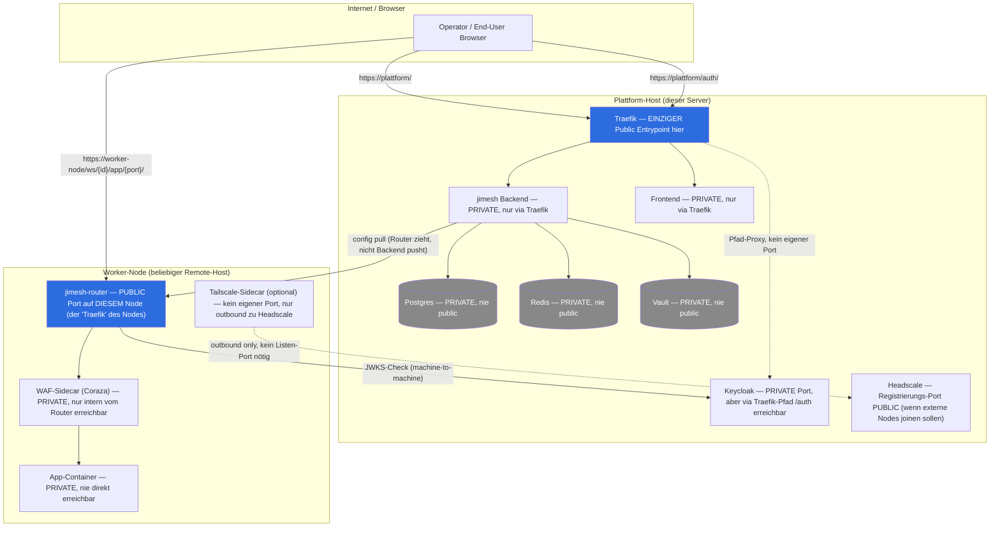
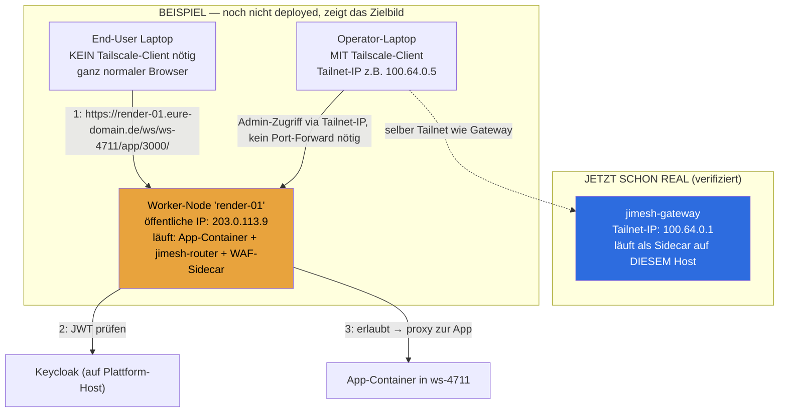

# Networking & Deployment-Strategie (verbindlich, ersetzt lose Diskussion)

> Stand 15.9.2026. Dieses Dokument beschreibt NUR, was gebaut/verifiziert ist
> vs. was die Ziel-Strategie ist. Nichts hier wird durch Chat-Copy-Paste-
> Befehle umgesetzt — jede Host-nahe Änderung läuft über Code (Go, geprüft
> mit `go build`/`go vet`) oder normales `docker run`/`docker compose`,
> nie über manuelle iptables/sysctl-Kommandos.

## 1. Der eine Satz, der alles entscheidet

**Es gibt nicht ein Netzwerk-Problem, sondern zwei getrennte Zugriffs-Ebenen,
die beide "ein Gateway, kein iptables" folgen sollen — aber unterschiedliche
Werkzeuge dafür brauchen:**

| Ebene | Was läuft wo | Gateway-Baustein | Status |
|---|---|---|---|
| A. JiMesh-Plattform selbst (Dashboard, API) | Auf DIESEM Host | Traefik | ✅ gebaut, verifiziert |
| B. Deployte User-Apps (Workspaces) | Auf beliebigen Remote-Nodes | `jimesh-router` (Workspace-Proxy) | Code existiert (TASK-079), nie live deployed |

Beides sind **normale Docker-Container**, deployed über den bestehenden
SSH+`docker run`-Mechanismus (`internal/deploy/projects_ssh.go`) — derselbe
Weg, über den heute schon jede Workspace-App deployed wird. Kein neues
Host-Script, keine neue Fähigkeit.

---

## 2. Ebene A: JiMesh-Plattform (heute fertig)

**Verifiziert heute:** `/` → Frontend (200), `/health` + `/api/*` → Backend
(200/401 korrekt), Headplane → eigener Port `:9082` (kein Pfad-Konflikt).
Alte Einzelports (19090/19091) sind weg. gRPC (19092) bleibt bewusst direkt
(Traefik kann hier kein gRPC routen) — auf `127.0.0.1` korrigiert.

---

## 3. Ebene B: Deployte User-Apps (Ziel, noch nicht live)

### 3.1 Ist-Zustand (das eigentliche Problem)

Jede App bekommt ihren eigenen Port, jeder Zugriff braucht einen eigenen
manuellen SSH-Tunnel. Kein zentrales Gateway. Das ist der Bruch, den du zu
Recht kritisiert hast.

### 3.2 Ziel-Zustand (Code existiert bereits, TASK-079)

**Eine URL statt SSH-Tunnel.** `jimesh-router` läuft als normaler Container
auf dem Node (gleicher `docker run`-Weg wie jede App), zieht seine
Routing-Tabelle vom Backend (`/api/router/config`, Long-Poll), prüft jeden
Request per echtem Keycloak-JWT + Ownership, bevor er zur App durchreicht.
**Kein SSH-Tunnel mehr nötig, kein eigener Port pro App.**

**Was dafür noch fehlt:** `jimesh-router` als Deploy-Schritt in
`projects_ssh.go` verdrahten (ein weiterer `docker run` neben dem
App-Container, kein neues Konzept) + Keycloak-JWKS-URL vom jeweiligen Node
aus erreichbar machen.

---

## 4. Der Login-Flow, den du beschrieben hast (Ziel)

**Das ist Headscales eingebauter Device-Flow** — kein Pre-Auth-Key nötig,
funktioniert automatisch, sobald Headscale OIDC konfiguriert hat
(`oidc:` Sektion in `config/headscale/config.yaml`, aktuell nicht gesetzt).
Passt direkt an das schon vorbereitete, aber deaktivierte Google/GitHub-
Identity-Brokering in Keycloak (`deploy/keycloak/jimesh-realm.json`,
`"enabled": false` — siehe frühere Antwort heute).

**Das ersetzt den Pre-Auth-Key-Weg, den ich vorher gebaut habe**, für genau
den Fall "Mensch deployed interaktiv" — Pre-Auth-Keys bleiben nur für
vollautomatische, unbeaufsichtigte Provisionierung sinnvoll (z.B. CI).

---

## 5. Was NICHT weiterverfolgt wird (heute verworfen)

- ❌ Firewall-Scoping über `jimesh-router`s Postgres/Redis-Alias-System für
  Headscale — falsches Werkzeug (Alias-`Kind` ist hart auf
  `postgres`/`redis` beschränkt), verworfen.
- ❌ Manuelle iptables-Regeln für Node-IPs — nie wieder chat-gesteuert.
- ❌ Eigenständiges Firewall-Script als "Slop" — verworfen, siehe Ebene B
  oben als eigentlicher Ersatz.

## 5b. Wo steht was — Public/Private je Komponente (konkret)

| Komponente | Wo | Public/Private | Warum |
|---|---|---|---|
| Traefik | Plattform-Host | **Public** | Einziger Eingang für Dashboard/API — das ist der ganze Sinn |
| jimesh Backend | Plattform-Host | Private | Nur über Traefik, nie eigener Port |
| Frontend | Plattform-Host | Private | Nur über Traefik |
| Keycloak | Plattform-Host | Private Port, aber **über Traefik-Pfad erreichbar** | Browser muss zum Login hinkommen — aber nicht über einen zweiten öffentlichen Port, sondern über denselben Traefik-Eingang (Pfad `/auth`), sonst haben wir wieder zwei Gateways |
| Postgres/Redis/Vault | Plattform-Host | **Nie public** | Kein Grund, je von außen erreichbar zu sein |
| Headscale (Registrierung) | Plattform-Host | **Public NUR wenn externe Nodes joinen sollen** | Ist die einzige Komponente hier, die zwingend von außen erreichbar sein MUSS, wenn Remote-Nodes real beitreten — durch Pre-Auth-Key bzw. OIDC-Device-Flow geschützt, nicht offen |
| `jimesh-router` | JEDER Worker-Node | **Public auf DIESEM Node** | Das ist der "Traefik" des Worker-Nodes — genau EIN Port pro Node, alles andere dahinter |
| WAF-Sidecar | Worker-Node | Private | Nur vom Router auf demselben Node erreichbar, nie eigener Host-Port |
| App-Container | Worker-Node | **Nie direkt erreichbar** | Immer nur über den Router-Proxy dieses Nodes |
| Tailscale-Sidecar (falls genutzt) | Worker-Node | Kein Port nötig | Nur ausgehende Verbindung zu Headscale, kein Listener |

**Kurzfassung der Regel:** Pro Host (egal ob Plattform oder Worker-Node)
genau **ein** Port ist der öffentliche Eingang. Alles andere auf diesem
Host redet nur intern über Docker-Netzwerke mit diesem einen Eingang.
Zwei Hosts = zwei solcher Eingänge (einer pro Host), nicht mehr.

## 5c. Konkretes Beispiel mit echten Werten (Worker-Node + zugreifender User)

Reale, aktuell live geprüfte Werte aus diesem Stack (`headscale nodes list`,
15.9.2026) plus ein Beispiel-Worker-Node und Beispiel-User zur Illustration:

**Der entscheidende Unterschied zwischen den beiden Pfeil-Typen oben:**

| Wer greift zu | Braucht Tailscale-Client? | Warum |
|---|---|---|
| **End-User** (nutzt die deployte App) | ❌ Nein | Geht über `jimesh-router`s ganz normale HTTPS-URL (Abschnitt 3.2) — das ist ja der ganze Sinn, kein VPN für Endnutzer |
| **Operator** (will den Worker-Node selbst administrieren, SSH, Logs, Debugging) | ✅ Ja | Erreicht den Node über seine Tailnet-IP statt öffentlichen SSH-Port — genau der Fall, für den Headscale gedacht ist |

**Antwort auf "können wir den Client hier installieren, damit wir reinkommen":**
Ja — für den **Operator-Zugriff** (Administration, nicht End-User-Traffic)
macht das Sinn: Operator-Laptop joint denselben Tailnet wie der
`jimesh-gateway`-Node (`100.64.0.1`, aktuell real registriert), dann sind
alle gejointen Worker-Nodes über ihre Tailnet-IP erreichbar, ganz ohne
offene SSH-Ports im Internet.

## 6. Nächste konkrete Schritte (Reihenfolge)

1. Headscale-OIDC gegen Keycloak konfigurieren (Device-Flow, Abschnitt 4).
2. `jimesh-router` als Deploy-Schritt in `projects_ssh.go` verdrahten
   (normaler `docker run`, kein Host-Script).
3. SSH-Tunnel-Anzeige im Frontend durch die `/ws/{id}/app/{port}/`-URL
   ersetzen, sobald 2. steht.
4. Vault-Root-Token + Keycloak-Default-Passwort aus `docker-compose.yml`
   in `.env` verschieben (heutiger Sicherheits-Fund, separat, unabhängig
   von 1-3).
